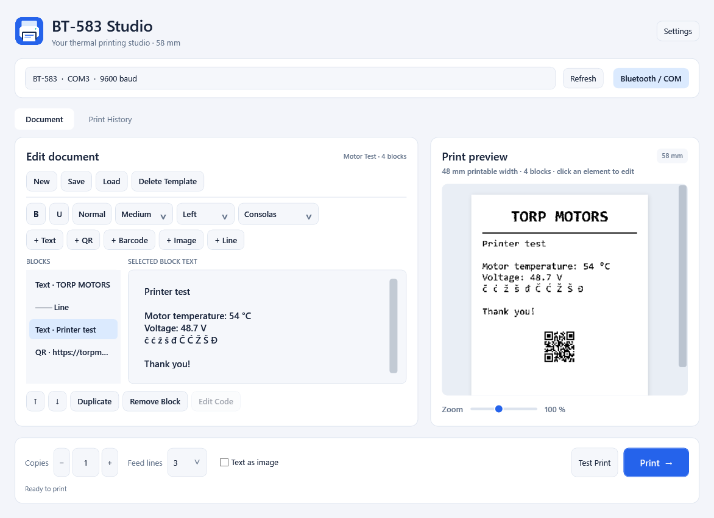
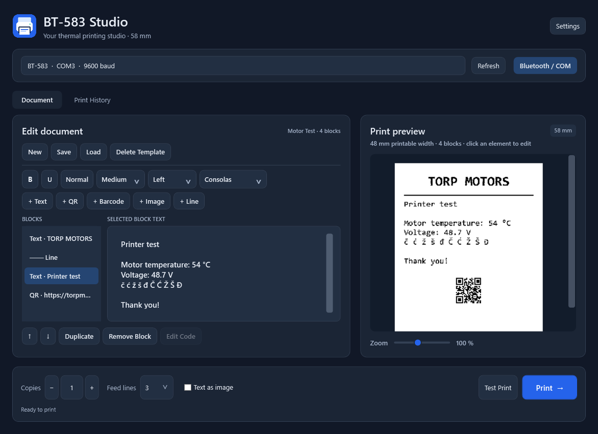

# BT-583 Studio

An offline Windows desktop editor for 58 mm thermal printers. Compose text, images, QR codes, barcodes, and separators; preview documents, save templates, and reprint from local history.

Built with WPF and .NET 8 for Windows 10/11 x64. No account, cloud service, or database is required. Internet is needed only to restore uncached development dependencies.

## Screenshots

The document editor includes block navigation, formatting controls, a live print preview, and quick access to printing options.

### Light theme



### Dark theme



## Build and run

Install the .NET 8 SDK on Windows. In Visual Studio, install the .NET desktop development workload and open `BT583Printer.sln`.

```powershell
dotnet restore BT583Printer.sln
dotnet build BT583Printer.sln -c Release --no-restore
dotnet test BT583Printer.sln -c Release --no-build
dotnet run --project src/BT583Printer/BT583Printer.csproj
```

Create a portable Windows x64 release:

```powershell
./publish.ps1 -Test
```

The script uses `.tools/dotnet/dotnet.exe` when available, otherwise the SDK on PATH. Run `publish/win-x64/BT583Printer.exe`. The self-contained package includes .NET; users need no separate runtime or Visual Studio. First launch may take longer while native libraries are extracted. Trimming is disabled for WPF.

## First print and connections

1. Connect the printer and install its Windows driver.
2. Select the intended printer and check connection, printable width, and DPI in **Settings**.
3. Use **Test Print**, then check the paper output and scan its QR code.
4. Edit your document, review the preview, and select **Print**.

| Connection | Behavior |
| --- | --- |
| WindowsDriver (default) | Renders through the standard Windows driver; no RAW ESC/POS support required. |
| WindowsRaw | Sends ESC/POS bytes through the selected Windows print queue; requires a compatible printer. |
| Serial | Sends ESC/POS through an outgoing Bluetooth SPP or serial COM port. |

For USB, check Windows **Printers & scanners**, the queue's online status, paper orientation, and the driver. Set the driver to 58 mm roll paper with suitable margins. Drivers may override the requested page size; check settings if output is clipped, has excessive feed, or uses A4 paper.

For Bluetooth, pair the device and find its outgoing SPP COM port in Device Manager or Bluetooth COM port settings. Configure the port and baud rate in **Settings**. Defaults are COM3, 9600 baud, 8 data bits, no parity, 1 stop bit, and no handshake; verify these for your device. Close other applications using the port. The application opens it only while sending and drains the output buffer before closing. BLE devices without SPP/COM need a supported Windows driver.

## Editor and templates

Formatting applies to the entire selected text block. Add separate blocks for different styles. Choose bold, underline, size, alignment, and font. **Normal** resets bold and underline and selects medium size. Move, duplicate, or remove blocks using the controls. Click an element in the preview to select its block. Zoom ranges from 65% to 150%.

Add text, QR codes, CODE128/EAN13 barcodes, PNG/JPG/BMP images, and separator lines. **Edit Code** changes an existing code. EAN13 accepts 12 digits for an automatic checksum or 13 with a valid checksum. CODE128 content must be supported by the encoder and fit the paper width. QR codes include a quiet zone.

Images up to 20 MB are embedded in the document, scaled down to fit, and converted to monochrome with optional Floyd–Steinberg dithering. The preview shares raster rendering with driver and raster printing. Native text and QR output may differ.

Templates are local JSON files. Overwriting or deleting a template requires confirmation. Unsaved changes trigger a prompt before replacing the document or closing. History retains the last 100 successfully submitted jobs. **Open in Editor** opens a copy; **Print Again** uses current printer settings, feed, and copies.

| Shortcut | Action |
| --- | --- |
| Ctrl+N | New document |
| Ctrl+S | Save template |
| Ctrl+O | Load template |
| Ctrl+D | Duplicate selected block |
| Ctrl+P | Print |
| Ctrl+Shift+P | Test print |

Copies: 1–99. Feed: 0–5 lines, default 3. Feed changes update the preview immediately.

## Unicode and ESC/POS compatibility

- **Automatic:** RAW/Serial uses native text for ASCII. Non-ASCII text uses raster until code page support is marked verified; native text is then used only if the selected encoding represents every character.
- **Raster / Text as image:** renders all elements as bitmaps. Croatian and other Unicode characters do not depend on printer code pages, but the Windows font must contain the required glyphs.
- **EscPos:** forces native text and reports unrepresentable characters instead of silently replacing them. Font selection affects raster text; native fonts are chosen by the printer.
- **WindowsDriver:** always renders through the driver. Native text/QR settings apply to RAW and Serial.

Encoding and the printer's `ESC t` code page ID are separate settings. CP852 defaults to ID 18 as a starting point; verify the correct value in the firmware manual or printer self-test. Selecting UTF-8 does not activate vendor-specific UTF-8 modes. Use raster if the necessary device mode has not been configured.

Paper width is 58 mm. Printable width is configurable from 20 to 58 mm (default 48 mm); default DPI is 203. Raster width is `round(mm × DPI / 25.4)`: 48 mm at 203 DPI gives 384 dots. These settings do not measure the printer automatically.

Raster output uses generic `GS v 0` strips of at most 128 rows. Native QR uses `GS ( k` only when explicitly enabled in Settings. Verify firmware support. Barcodes are rasterized and require no native barcode command. The application sends no cutter or cash drawer commands.

## Local data and troubleshooting

Data is stored in `%LocalAppData%\BT583Printer`:

| Path | Contents |
| --- | --- |
| settings.json | Printer, connection, width, encoding, font, theme, and feed |
| Templates/*.json | Documents with embedded images |
| history.json | Last 100 submitted jobs |
| Logs/yyyy-MM-dd.log | Technical error details |

JSON writes use temporary files and replacement. Unreadable files are preserved for recovery. Close the application and back up files before manual repair. Data is unencrypted and protected by your Windows account. Use one instance when saving local data.

- **Printer missing/offline:** Refresh and check its name, Windows queue, and connection. Status depends on the driver and may be inaccurate for Bluetooth.
- **Blank/incorrect print:** check paper orientation, driver, and connection mode. Use raster for incorrect characters; reduce printable width and verify DPI for clipped output.
- **COM unavailable:** verify the outgoing SPP port and baud rate, and close applications using the port.
- **Unreadable QR:** disable native QR, try medium/large size, and verify width/DPI. Avoid shrinking dense codes unnecessarily.

A submitted job means the driver, spooler, or COM transport accepted data; it does not confirm physical printing. A connection failure may leave a partial print. Check the queue and paper before retrying.

## Project layout and validation

| Path | Purpose |
| --- | --- |
| src/BT583Printer/MainWindow.xaml | Editor, preview, history, and controls |
| src/BT583Printer/MainWindow.xaml.cs | UI actions |
| src/BT583Printer/FormDialog.cs | Themed modal forms |
| src/BT583Printer/Models/ | Document types and printer settings |
| src/BT583Printer/Services/ | Transports, ESC/POS, persistence, and logging |
| src/BT583Printer/Rendering/ | Shared rendering, raster packing, and dithering |
| tests/BT583Printer.Tests/ | Functional and WPF rendering tests |
| tools/create-icon.py | Reproducible icon generator; requires Python and Pillow |

GitHub Actions builds and tests on Windows. Tests send no print jobs. Physical delivery, printed-code scanning, and firmware compatibility require hardware checks. See [validation notes](docs/VALIDATION.md) and [contributing](CONTRIBUTING.md).

Runtime dependencies: ZXing.Net 0.16.11 and System.IO.Ports 8.0.0. xUnit and Microsoft.NET.Test.Sdk are test dependencies. See [third-party notices](THIRD-PARTY-NOTICES.md). A license for this project's own code has not yet been selected.
